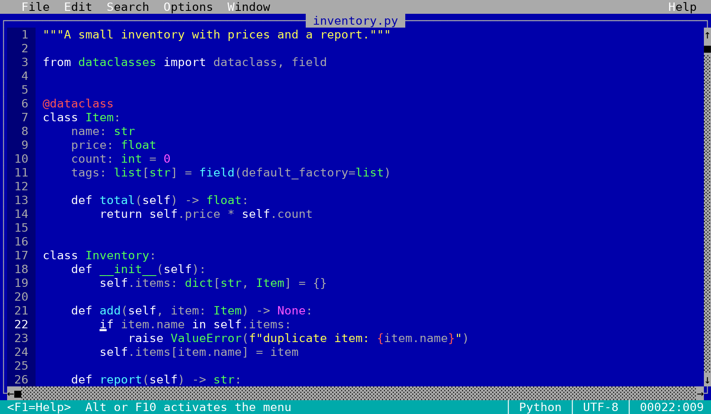
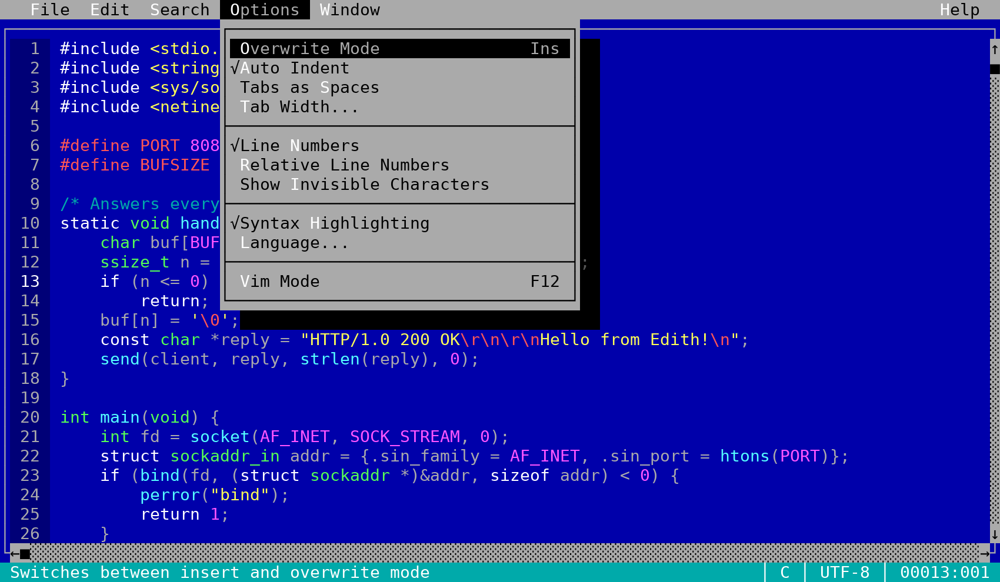
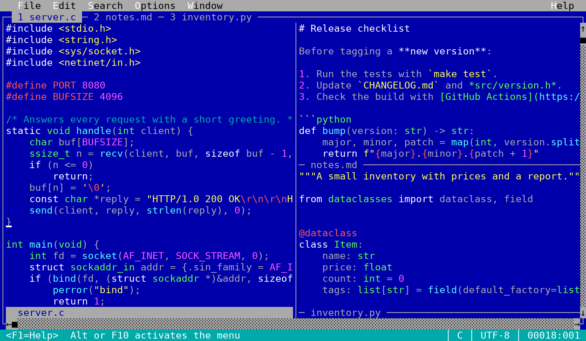
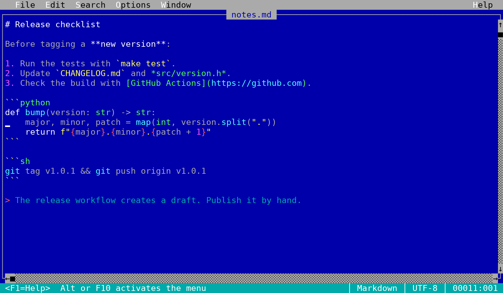
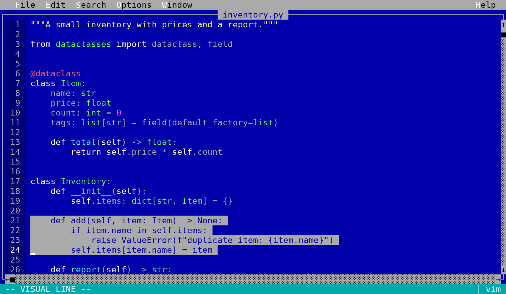

# Edith

[](https://github.com/dlehmann/edith/actions/workflows/release.yml)

A friendly text editor for the terminal, in the spirit of the classic MS-DOS `EDIT`: pull-down
menus, dialogs and mouse support – plus split windows and tabs, syntax highlighting with
tree-sitter for more than 50 languages, code formatting and an optional, faithful Vim mode.

Everything – including the grammars of all languages – is compiled into a single executable.
The user interface is available in English, German, French,
Spanish, Italian, Hungarian, Polish and Klingon.

**Website:** [dlehmann.github.io/edith](https://dlehmann.github.io/edith/)



## Features

- **Easy to use:** menus (Alt or F10), dialogs, the usual shortcuts (Ctrl+S, Ctrl+Z, Ctrl+F,
  ...), selecting with Shift and the mouse, the system clipboard (OSC 52), bracketed paste.
- **Syntax highlighting** with [tree-sitter](https://tree-sitter.github.io) and the queries of
  nvim-treesitter, including embedded languages (HTML in PHP, JavaScript/CSS in HTML, code
  blocks in Markdown, regular expressions, ...). Languages without a grammar use a built-in
  fallback lexer.
- **Split windows and tabs**, the same file in several windows with their own cursors.
- **Reformat Code** (F8) with the standard formatter of the language when it is installed,
  otherwise with the built-in JSON formatter or by re-indenting along the syntax tree.
- **Vim mode** (Options > Vim Mode or `--vim`) that follows Vim's documented behavior:
  operators, text objects, registers, macros, marks, Vim regular expressions, Ex commands,
  mappings and more.
- Files are kept in their format: UTF-8 or Latin-1, LF or CRLF, with or without BOM. Saving
  replaces a file only after the new text has been written completely.
- Works in any terminal with 16 colors; true color terminals get the original CGA palette.

## Screenshots

| | |
|---|---|
|  |  |
| Menus and dialogs | Split windows and tabs |
|  |  |
| Embedded languages: code blocks in Markdown | Vim mode |

The screenshots are made by `tools/screenshots.py` from the files in `docs/screenshots/samples/`.

## Installation

Edith runs on Linux and macOS in any terminal emulator that speaks UTF-8 (see
[Terminals](#terminals)). Each [release](https://github.com/dlehmann/edith/releases) provides
ready-made packages:

**Arch Linux, CachyOS, Manjaro, EndeavourOS**

```bash
curl -LO https://github.com/dlehmann/edith/releases/latest/download/edith-editor-x86_64.pkg.tar.zst
sudo pacman -U edith-editor-x86_64.pkg.tar.zst
```

To build it yourself instead, download the `PKGBUILD` of the release and run `makepkg -si` in
its directory. The package is called `edith-editor` (the name `edith` is taken in the AUR).

**Debian, Ubuntu, Linux Mint, Pop!_OS**

```bash
curl -LO https://github.com/dlehmann/edith/releases/latest/download/edith_amd64.deb
sudo apt install ./edith_amd64.deb
```

**macOS (Apple Silicon, macOS 11 or newer)**

```bash
curl -LO https://github.com/dlehmann/edith/releases/latest/download/edith-macos-arm64.tar.gz
tar -xzf edith-macos-arm64.tar.gz
sudo mkdir -p /usr/local/bin && sudo install -m755 edith-*-macos-arm64/edith /usr/local/bin/
```

The binary is not notarized by Apple. Downloaded with `curl` as above it runs directly; if you
downloaded it with a web browser, allow it once with `xattr -d com.apple.quarantine edith`.
For Intel Macs build it from the source tarball of the release (see below).

**Any Linux distribution**

| Download | Use |
|----------|-----|
| AppImage (`Edith-<version>-x86_64.AppImage`) | `chmod +x Edith-*.AppImage && ./Edith-*.AppImage file.txt` |
| Static binary (`edith-<version>-linux-x86_64.tar.gz`) | unpack and copy `edith` to a directory in `PATH` |

The command is always `edith`. These packages do not update themselves: install a new release
the same way.

### Building from source

Building needs a C++17 compiler (g++ or clang++), `make`, `git`, `curl` and `python3` for the
tests. The Swift, Perl and LaTeX parsers are generated from their grammars; for them the
download script fetches the tree-sitter CLI, which needs `node`.

```bash
tools/fetch-grammars.sh   # once: downloads tree-sitter and the grammars into third_party/
make -j$(nproc)           # builds ./edith
make install              # optional: installs to ~/.local (PREFIX=/usr/local ...)
```

`make STATIC=1` links statically (needs a static libc and libstdc++), `make help` lists all
targets. The source tarballs of the releases (`edith-<version>.tar.gz`, made by `make dist`)
already contain `third_party/` and build without network access – on Linux and on macOS
(with the Xcode Command Line Tools: `make && make install`).

## Usage

```bash
edith file.txt             # open a file
edith -n file.txt          # with line numbers (-r: relative line numbers)
edith --vim file.txt       # with the Vim key bindings
edith a.c b.c              # several files in tabs (-o / -O: in split windows)
edith --lang=fr            # the UI language (default: from the locale)
edith --version            # show the version
edith --help               # all options
```

F1 shows the key bindings, F10 or Alt opens the menu.

| Keys | Action |
|------|--------|
| Ctrl+N / Ctrl+O / Ctrl+S / Ctrl+Q | new / open / save / exit |
| Ctrl+Z / Ctrl+Y | undo / redo |
| Ctrl+X / Ctrl+C / Ctrl+V / Ctrl+A | cut / copy / paste / select all |
| Ctrl+F / F3 / Ctrl+R / Ctrl+G | find / find next / replace / go to line |
| Shift+movement, mouse drag, double-click | select |
| Tab / Shift+Tab | indent / unindent the selected lines |
| F8 | reformat code |
| F6 / Shift+F6, Ctrl+W | next / previous window, close window |
| Ctrl+T, F4, Ctrl+PgDn / Ctrl+PgUp | new tab, close tab, next / previous tab |
| F12 | Vim mode on / off |

Find and Change can search for regular expressions (check box "Regular Expression"):
`( ) | + ? {n,m} . [ ] ^ $ \d \w \s`, `<` and `>` for the start and end of a word (Vim's
"very magic" syntax, but `= & ~ @ %` are plain characters). In the replacement `\0` is the match, `\1` to `\9` are the groups and
`\n` is a line break.

## Windows and tabs

The Window menu splits the editor horizontally or vertically, closes windows and opens, closes
and switches tabs. A click activates a window, dragging a status line or the border between
windows resizes them, and the tabs are shown in the top line. In Vim mode the same works with
`Ctrl-W s v n c q o w W h j k l t b p + - _ | < > = T`, `gt`, `gT` and `:split :vsplit :new
:vnew :close :only :resize :vertical :wincmd :tabnew :tabedit :tabclose :tabonly :tabnext
:tabprevious :tabfirst :tablast :tabmove :tabs`, `:wa :qa :wqa :xa`.

## Reformat Code

Edit > Reformat Code (F8, in Vim mode also `:Format`) formats the file with the standard
formatter of its language when it is installed: clang-format (C, C++, C#, Java, also
JavaScript/TypeScript), prettier (JavaScript, TypeScript, CSS, SCSS, HTML, JSON, Markdown,
YAML), ruff / black / autopep8 (Python), gofmt, rustfmt, zig fmt, shfmt, fish_indent, stylua,
rufo, perltidy, ktlint, swift-format, scalafmt, ormolu, mix format, erlfmt, xmllint, taplo,
terraform fmt, nixfmt, sql-formatter and cmake-format. The formatter runs in the file's
directory, so project settings such as `.clang-format`, `.prettierrc` or `pyproject.toml`
apply; without a `.clang-format` the tab settings of Edith are used.

Formatters run only when you choose Reformat Code, never on opening or saving a file. Some of
them read configuration that is itself code (for example `prettier.config.js`), so reformatting
a file of a project you do not trust runs that project's code, just as running the formatter in
a shell would.

The formatters are optional. Without one, JSON is formatted by Edith itself and other languages
are re-indented by their syntax tree with the indentation rules of nvim-treesitter (the same
rules Neovim uses for `=`); Python, YAML, Makefiles and Markdown keep their indentation, since
it has a meaning there. White space at line ends is removed (not in strings and not in
Markdown). The result is one undo step.

## Vim mode

Options > Vim Mode (F12, or `--vim`) turns on Vim key bindings that follow Vim's documented
behavior:

- Normal, Insert, Replace, Visual (characterwise, linewise, blockwise), Operator-pending and
  Command-line mode, Insert Normal mode (`Ctrl+O`)
- motions (`hjkl w b e ge W B E f t ; , 0 ^ $ g_ | gg G % H M L { } ( ) [( ]} [[ ]] go`,
  marks, jump list, change list), counts, operators (`d c y < > = ! g~ gu gU g? gq gw`),
  forced motions (`dv`, `dV`), text objects (`iw aw iW aW is as ip ap i( a( i{ i[ i< it at i" i' i``)
- registers (`"a`–`"z`, appending with `"A`, `"0`–`"9`, `"-`, `"_`, `". ": "/ "%`, `"+`/`"*`
  for the clipboard, `clipboard=unnamedplus`), `p P gp gP ]p [p`, Visual `p`/`P`
- undo/redo with Vim's grouping, the dot command (also for Visual mode and inserts with
  counts), macros (`q`, `@`, `@@`, `@:`, recursive macros), `Ctrl+A`/`Ctrl+X`
- searching with Vim patterns (magic, `\v`, `\zs`, `\<\>`, groups, multi-line), offsets,
  `n N * # g* g# gd`, `'hlsearch'`, `'ignorecase'`, `'smartcase'`, `'wrapscan'`
- Ex commands with ranges: `:s` (all flags, `\1 & ~ \u \U \r`), `:g`/`:v`, `:normal`, `:d :y
  :pu :m :t :j :> :<`, `:w :q :wq :x :e :r :sav :up`, `:sort`, `:retab`, `:left :center
  :right`, `:!` filters, `:r !cmd`, `:w !cmd`, `:set` (`ts sw et ai nu rnu ic scs ws hls tw nf
  cb ...`), `:map`/`:noremap` for every mode with `<Leader>` and timeouts, `:registers`,
  `:marks`, `:jumps`, `:changes`, `:undo`, `:redo`
- Insert mode keys `Ctrl+W Ctrl+U Ctrl+T Ctrl+D Ctrl+R Ctrl+A Ctrl+V Ctrl+K Ctrl+N Ctrl+P
  Ctrl+E Ctrl+Y`, autoindent and `'textwidth'`

The menus stay available with Alt and F10; Ctrl+S saves and Ctrl+Q exits in every mode.
In menus and dialogs h j k l move like the arrow keys (also without Vim mode; not in input
fields); menus and menu entries are chosen with Alt+letter.
Not supported: hidden buffers and the buffer list commands (`:b`, `:bn`), folding, Vim script
expressions, the undo tree.

## Terminals

Edith talks to the terminal directly (no terminfo, no ncurses) with the escape sequences that
every current terminal emulator understands, and is tested with the key sequences of xterm,
VTE (GNOME Terminal, Tilix, ...), Konsole, kitty, Alacritty, WezTerm, foot, rxvt/urxvt, tmux,
GNU screen and the Linux console. The shell does not matter: Edith runs the same from bash, zsh,
fish or any other shell, and runs shell commands (formatters, Vim's `:!`) with `/bin/sh`.

- The terminal has to use **UTF-8** (all current terminals do by default).
- Colors: 16 colors everywhere; true color when `COLORTERM` says so (or `EDITH_COLORS=24`). On
  the Linux console bright colors are shown as bold.
- On macOS, let the Option key work as Alt for the menu shortcuts: Terminal.app > Settings >
  Profiles > Keyboard > "Use Option as Meta key", in iTerm2 Profiles > Keys > Left Option key
  "Esc+". F10 opens the menus anyway (on laptops with Fn+F10).
- Alt alone opens the menu only in terminals with the kitty keyboard protocol (kitty, foot,
  WezTerm, Ghostty, recent Alacritty); F10 and Alt+letter work everywhere.
- Over slow connections set `ESCDELAY=100` (milliseconds) if keys such as the arrows arrive
  as Esc and letters.
- With tmux, enable the mouse and true color passing as usual (`set -g mouse on`,
  `set -as terminal-features ",*:RGB"`).
- `TERM=dumb` (for example the shell buffer of Emacs) cannot show a full-screen program;
  Edith says so and exits.
- Edith gives the terminal back and redraws itself when the shell stops and continues it.

## Configuration

| Setting | Effect |
|---------|--------|
| `LANGUAGE`, `LC_ALL`, `LC_MESSAGES`, `LANG` | the UI language (`de_DE.UTF-8`, `fr`, `tlh`, ...); other locales fall back to English; `--lang=CODE` overrides it |
| `EDITH_COLORS=16` / `EDITH_COLORS=24` | force 16 colors / true color (default: from `COLORTERM`) |
| `ESCDELAY` | milliseconds to wait for the rest of an escape sequence after Esc (default 30) |
| `~/.config/edith/formatters` | formatter commands per language (also `$XDG_CONFIG_HOME/edith/formatters`) |

The formatter configuration has one line per language:

```
# language = command     ({file} = the file name, {tabwidth} = the tab width,
#                         {clangstyle} = clang-format's --style option, {xmlindent} = the indentation)
Python = black -q --stdin-filename {file} -
C = clang-format --style=Google --assume-filename={file}
JSON = builtin
Rust = none
```

The command is run with `/bin/sh` in the file's directory, the text on its standard input; the
formatted text is read from its standard output. `{file}` is already quoted for the shell.

## Contributing

Contributions are welcome – bug reports, translations, new languages and code. See
[CONTRIBUTING.md](CONTRIBUTING.md) for how to build, test and extend Edith, and
[docs/ARCHITECTURE.md](docs/ARCHITECTURE.md) for a tour of the source code. Changes are
listed in [CHANGELOG.md](CHANGELOG.md). Security problems are reported privately, see
[SECURITY.md](SECURITY.md).

## License

Edith is released under the [MIT License](LICENSE).

Third-party code that is compiled into the binary (downloaded by `tools/fetch-grammars.sh`):

- tree-sitter: MIT (`third_party/tree-sitter/LICENSE`)
- Grammars: see `third_party/grammars/<language>/LICENSE` (mostly MIT; Apache-2.0: Erlang,
  Elixir, INI, HCL, Terraform; public domain: Clojure (CC0), Fish (Unlicense))
- Highlight, injection and indent queries from nvim-treesitter: Apache-2.0
  (`third_party/queries/LICENSE`)

The binary packages contain all these license texts in one file, `THIRD_PARTY_LICENSES`
(made by `tools/third-party-licenses.sh`).
